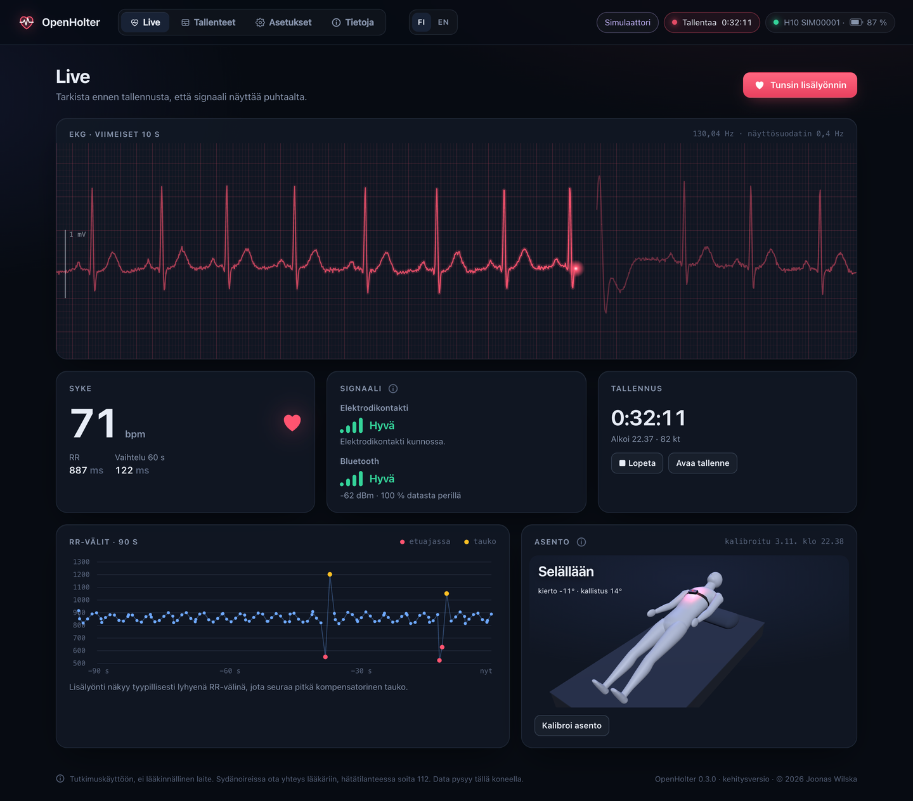
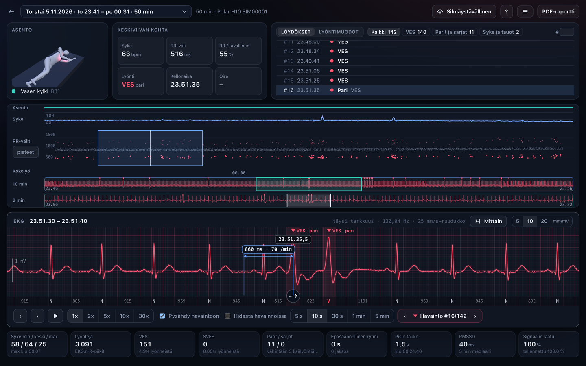
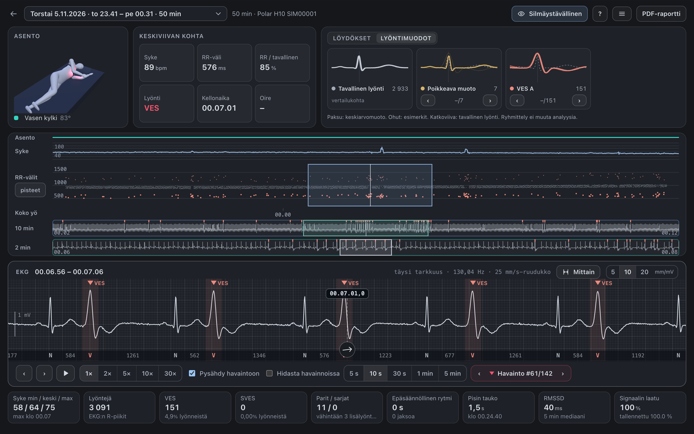
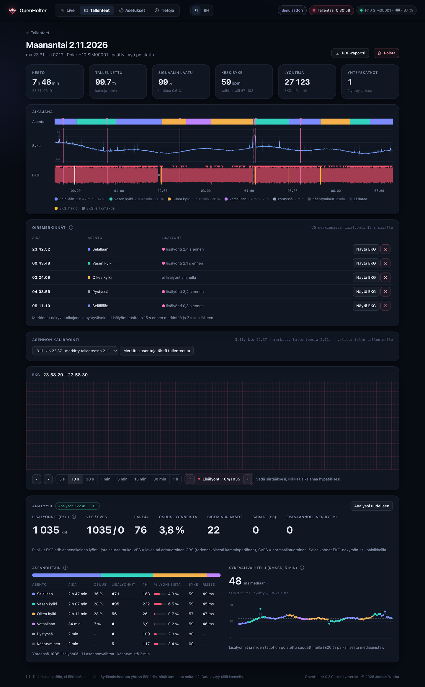
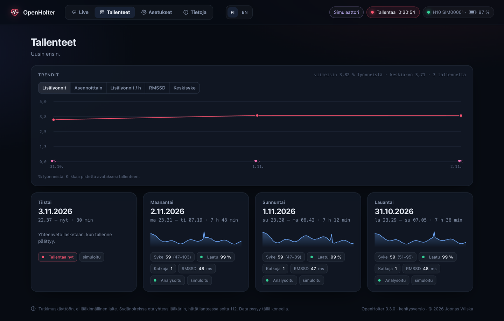
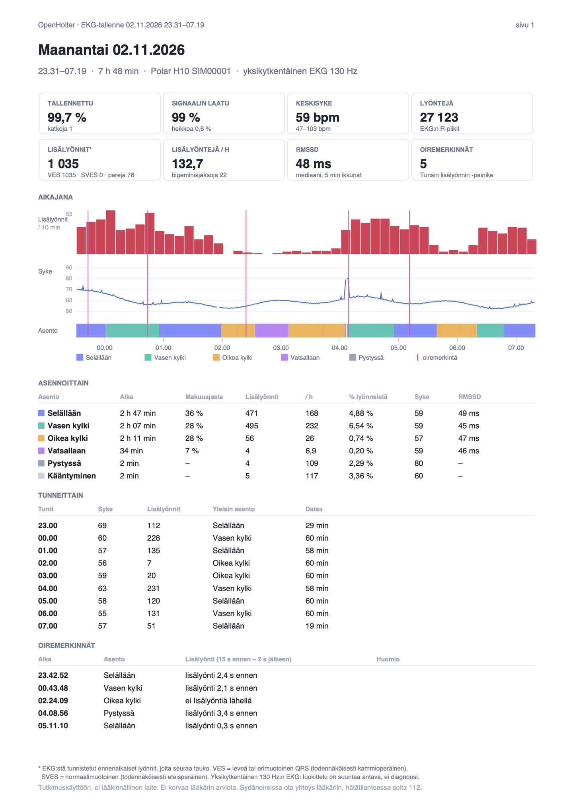
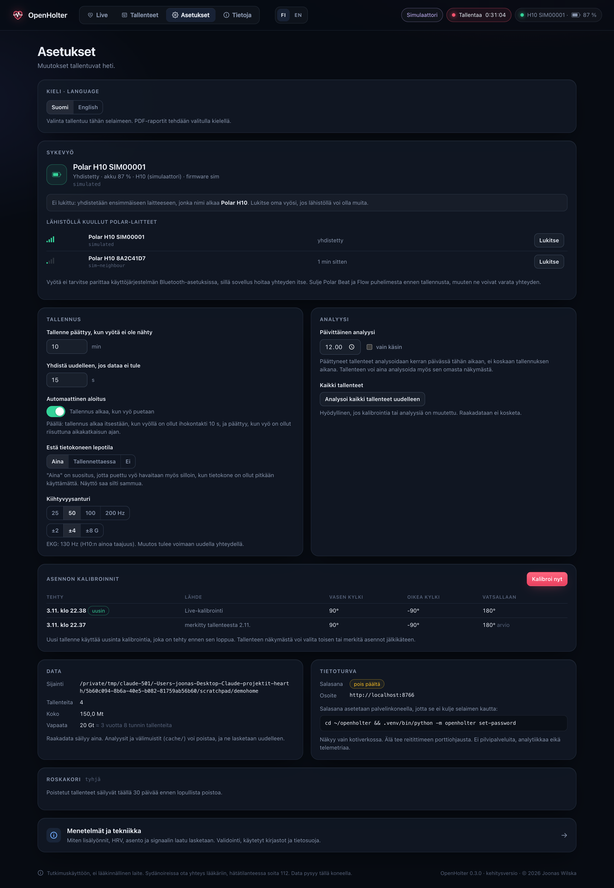
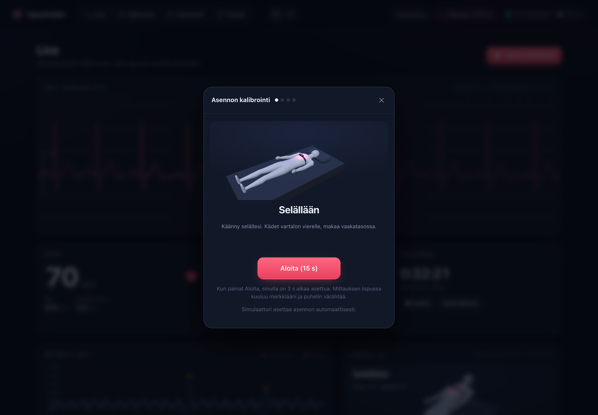
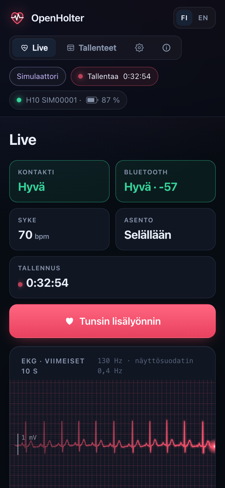

# OpenHolter

**Avoimen lähdekoodin EKG-tallennin Polar H10 -sykevyölle: jokainen lyönti analysoidaan, ja jokainen tulos validoidaan avoimesti.**

🇬🇧 [In English](README.md)

**Uusin versio: 0.5.3 (analyysiversio 6).** [Mitä muuttui](CHANGELOG.fi.md) · [Julkaisut](https://github.com/JoonasFI/OpenHolter/releases)



OpenHolter tekee Polar H10 -sykevyöstä ja tietokoneesta Holter-tyyppisen EKG-tallentimen.
Vyö lähettää yksikytkentäisen EKG:n (130 Hz) ja kiihtyvyysdatan Bluetoothilla. Tietokone tallentaa niin pitkään kuin haluat ja löytää
EKG:stä jokaisen sydämenlyönnin. Se merkitsee lisälyönnit (VES/SVES), kertoo, missä kehon asennossa ne tulevat,
ja tekee PDF-raportin, jossa on lääkäriä varten koko EKG. Kaikki data pysyy omalla koneella: ei pilveä, ei tiliä, ei telemetriaa.

> [!IMPORTANT]
> **Vain tutkimus- ja omaan käyttöön. Ei lääkinnällinen laite.**
>
> OpenHolter on avoimen lähdekoodin tutkimusprojekti. Sitä ei ole tarkoitettu sairauksien diagnosointiin, hoitoon,
> seurantaan tai ehkäisyyn, eivätkä sen tulokset korvaa lääkärin arviota. Älä muuta lääkitystäsi tai hoitoasi niiden perusteella.
> OpenHolter ei tunnista sydäninfarktia eikä hälytä vaarallisista rytmihäiriöistä.
>
> **Jos sinulla on sydänoireita, kuten rintakipua tai puristusta, hengenahdistusta, pyörtymistä tai huimausta, ota yhteys lääkäriin.
> Hätätilanteessa soita 112.**
>
> Raaka EKG säilyy aina kokonaan, joten automaattinen analyysi on lisäkerros, joka ei korvaa käyrän katsomista.

## Tulokset lyhyesti

Lyöntianalyysi on testattu samoin kuin kaupalliset rytmihäiriöalgoritmit: kardiologien merkitsemiä vertailuaineistoja
vastaan ANSI/AAMI EC57 -standardin mukaisesti: [MIT-BIH Arrhythmia Database](https://physionet.org/content/mitdb/1.0.0/),
[St Petersburg INCART 12-lead Arrhythmia Database](https://physionet.org/content/incartdb/1.0.0/),
[MIT-BIH Supraventricular Arrhythmia Database](https://physionet.org/content/svdb/1.0.0/) (SVDB) ja
[MIT-BIH Atrial Fibrillation Database](https://physionet.org/content/afdb/1.0.0/) (AFDB), kaikki PhysioNetistä.
Analyysiversio 6 säädettiin vain MIT-BIH:n puoliskolla (DS1). **SVDB ja AFDB ovat puhdas testi:** ne avattiin vasta, kun parametrit oli
lukittu. MIT-BIH ja INCART oli nähty edellisen version yhteydessä, joten niiden luvut ovat todennäköisesti optimistisia.

| Herkkyys / osuvuus | **SVDB, puhdas testi** (78 tallennetta) | MIT-BIH (44 tallennetta) | INCART (75 tallennetta) |
|---|---:|---:|---:|
| **Lyöntien (QRS) tunnistus** | **99,9 % / 99,4 %** | 99,9 % / 99,7 % | 99,8 % / 99,0 % |
| **VES** (kammioperäiset lisälyönnit) | **59,6 % / 79,5 %** | 82,4 % / 90,8 % | 78,1 % / 89,9 % |
| VES, tyypillinen yksittäinen + tauko | 88,5 % | 96,0 % | 92,3 % |
| **SVES** (eteisperäiset lisälyönnit) | **53,6 % / 75,1 %** | 32,9 % / 69,4 % | 87,6 % / 66,3 % |
| SVES, tyypillinen yksittäinen + tauko | 90,8 % | 90,0 % | 98,0 % |

Eteisvärinä AFDB:ssä, puhdas testi (233 tuntia, sekunneittain): **80,7 % / 99,1 %**.

- **Lyönnit löytyvät luotettavasti:** 99,8–99,9 % kaikista sydämenlyönneistä, vääriä löydöksiä on vähän.
- **Tyypilliset yksittäiset lisälyönnit**, jotka ovat yleisimpiä, löytyvät noin 9 tapauksessa 10:stä.
- **VES- ja SVES-kokonaismäärät ovat edelleen suuntaa antavia:** puhtaassa testissä VES-lyönneistä löytyi noin 60 % ja SVES-lyönneistä
  54 %. VES-merkinnöistä noin 8/10 ja SVES-merkinnöistä 3/4 oli oikeita. Ks. [Tunnetut heikkoudet](#tunnetut-heikkoudet-ja-seuraava-versio).

**Uutta analyysiversiossa 6:** uusi lyöntitunnistin, jonka kynnys seuraa viimeisiä lyöntejä, nosti QRS-herkkyyden MIT-BIH:ssä 97,4 %:sta
99,9 %:iin. Puhtaassa testissä tyypillisten yksittäisten SVES-lyöntien herkkyys nousi 63 %:sta 91 %:iin. Eteisvärinä vaatii nyt P-aallon
puuttumisen, mikä nosti sen osuvuuden puhtaassa testissä 95 %:sta 99 %:iin. VES-kokonaistulos ei parantunut puhtaassa testissä
(61,9 / 82,2 % → 59,6 / 79,5 %).

Menetelmä, tallennekohtaiset taulukot ja ohje testin toistamiseen: [docs/VALIDATION.md](docs/VALIDATION.md).
Luvut kuvaavat algoritmia vertailuaineiston Holter-tallenteilla; H10:n rintakytkentä on erilainen (ks. alla).

## Uutta: tarkastelunäkymä

*Kaikki kuvat on otettu sisäänrakennetulla simulaattorilla, eivät ole oikeaa potilasdataa.*



Tarkastelunäkymä näyttää koko tallenteen yhdellä noin 15 tuuman näytöllä, ja se on tehty niin, että poikkeamat löytyvät nopeasti.
Avaa se yläpalkin **Tarkastelu**-kohdasta tai tallenteen sivulta.

- **Löydökset numeroituina:** sarjat, parit, VES, SVES, epäsäännöllinen rytmi, pisimmät tauot ja sykkeen ääripäät aikajärjestyksessä.
  Suodattimet, siirtyminen numerolla (#) ja N/P seuraavaan ja edelliseen.
- **Koko yö yhdellä silmäyksellä:** asento, syke ja RR-välit pisteinä tai tiheyskarttana. Lisälyönnit ja tauot erottuvat koko yön joukosta.
- **Zoomausportaat:** koko yö → 10 min → 2 min → EKG. Laatikot näyttävät, mitä seuraava taso suurentaa, ja kaikkia voi raahata.
- **EKG täydellä tarkkuudella:** lyöntiluokat (N, V, S) ja RR-välit lyöntien välissä, mittain (ms ja /min, kiinnittyy R-piikkiin),
  vahvistus 5, 10 tai 20 mm/mV, toisto 1–30× sekä pysähdys tai pehmeä hidastus havainnoissa.
- **Asento** 3D-hahmona ja nuolena keskiviivan kohdalla.
- **Lyöntimuodot:** lyönnit ryhmiteltynä muodon mukaan (tavallinen, poikkeava, jokainen VES-muoto ja SVES) keskiarvoineen ja esimerkkeineen.
- **Silmäystävällinen tila** pitkään katseluun ja pikanäppäimet kaikkeen (?-ohje).



## Kuvakaappaukset

*Kaikki kuvat on otettu sisäänrakennetulla simulaattorilla, eivät ole oikeaa potilasdataa.*

| | |
|---|---|
|  |  |
| **Tallenne:** asennon, sykkeen ja EKG:n aikajana, oiremerkinnät, EKG täydellä tarkkuudella VES-merkintöineen ja analyysi asennoittain. | **Tallenteet ja trendit** tallenteiden yli. |
|  |  |
| **PDF-raportti** lääkärille: yhteenveto, EKG-liuskat 25 mm/s ja koko tallenteen EKG. | **Asetukset** selaimessa: oman vyön lukitus, automaattinen tallennus, lepotilan esto, päivittäinen analyysi, roskakori. |
|  |  |
| **Asennon kalibrointi** 3D-hahmon avulla; puhelin toimii kaukosäätimenä. | **Puhelimessa:** tarkista signaali ja paina *Tunsin lisälyönnin*, kun tunnet sellaisen. |

## Ominaisuudet

- **Live-näkymä:** EKG, syke, RR-välit, elektrodikontakti, Bluetooth-yhteyden laatu ja 3D-hahmo asennosta.
  Mitään mitattua ei näytetä ennen kuin vyö ilmoittaa ihokontaktin.
- **Automaattinen tallennus**, kun vyö puetaan (10 s yhtäjaksoinen ihokontakti), ja pysäytys, kun se riisutaan. Voi kytkeä pois.
- **Analyysi** (kerran päivässä, ei koskaan tallennuksen aikana, tai painikkeesta): R-piikit EKG:stä, ennenaikaiset lyönnit
  VES/SVES-luokiteltuina QRS-muodon mukaan, parit, sarjat ja bigeminia, lisälyönnit asennoittain ja tunneittain, HRV (RMSSD/SDNN).
  Epäsäännöllisen rytmin jaksot (sopivat eteisvärinään) ja vähintään kolmen lisälyönnin sarjat raportoidaan (suuntaa antava).
- **Asento** kiihtyvyysanturista: ohjattu kalibrointi ja jälkikalibrointi tallenteesta.
- **Oiremerkintä:** "Tunsin lisälyönnin"; tallenteesta näkee, mitä EKG:ssä tapahtui sillä hetkellä.
- **Tarkastelunäkymä:** koko tallenne yhdellä näytöllä, numeroidut löydökset, RR-kaavio, zoomausportaat, mittain ja lyöntimuodot (ks. yllä).
- **EKG:n toisto:** tallennetta voi toistaa 1–30-kertaisella nopeudella, ja toisto voi pysähtyä tai hidastua jokaisessa lisälyönnissä ja oiremerkinnässä. Keskiviivan yläpuolella näkyy tarkka kellonaika.
- **PDF-raportti:** yhteenveto, EKG-liuskat (oiremerkinnät, sarjat, parit, lisälyöntiesimerkit ja tuntinäytteet) ja koko tallenne.
- **Trendit**, **roskakori** (30 päivän säilytys) ja **asetukset** selaimessa.
- **Suomi ja englanti** käyttöliittymässä ja PDF:ssä (valinta yläpalkissa).
- **Analyysi paranee myös jälkikäteen:** se lasketaan aina raakadatasta, joten parempi versio analysoi myös vanhat tallenteet uudelleen.
- **Avoimesti validoitu** MIT-BIH-, INCART-, SVDB- ja AFDB-tietokannoilla.

## Tunnetut heikkoudet ja seuraava versio

Kerromme heikkoudet yhtä tarkasti kuin vahvuudet. Versiossa 6:

- **VES-määrä on todennäköisesti alakanttiin, ja osa merkinnöistä on vääriä.** Puhtaassa testissä noin 40 % VES-lyönneistä jäi
  löytymättä, ja noin joka viides merkintä oli väärä. Tulos vaihtelee paljon aineistoittain (MIT-BIH:ssä löytyy 82 %).
- **SVES-määrä voi olla väärin kumpaankin suuntaan.** Puhtaassa testissä noin puolet löytyi, ja noin joka neljäs merkintä oli väärä.
  Tallenteet, joissa eteislyönti on vallitseva rytmi (MIT-BIH 232, SVDB 822), jäävät lähes kokonaan löytymättä. Yksi virhe voi myös
  hylätä koko sarjan: SVDB-tallenteessa 865 noin 1 000 lyöntiä jäi merkitsemättä.
- **Epäsäännöllisen rytmin (eteisvärinän) tunnistus on vain suuntaa antava.** Puhtaassa testissä väärät hälytykset ovat harvinaisia, mutta
  yli puolet eteisvärinästä jäi löytymättä 5 tallenteessa 23:sta. INCARTissa löytyi 28 %, ja MIT-BIH:ssä joka neljäs ilmoitettu lyönti oli väärä.
- **Eri laite, eri kytkentä.** Vertailuaineistot on nauhoitettu Holter-laitteilla raajakytkennöillä. H10 mittaa yhden
  rintakytkennän 130 Hz:llä, josta P-aaltoa ja QRS-muotoa on vaikeampi tulkita kuin 12-kytkentäisestä EKG:stä.
  Tarkkuutta itse vyön kanssa ei ole vielä mitattu vertailulaitetta vastaan.
- **Mitä tämä tarkoittaa käytännössä:** automaattiset merkinnät ohjaavat katsetta, eivät korvaa katsomista.
  Löytymättä jäänyt lisälyönti on käyrällä, sitä ei vain ole korostettu. Siksi raportissa on koko EKG, ja siksi
  oiremerkinnät ovat tärkeitä: ne osoittavat kohdat, jotka kannattaa tarkistaa.

**Suunnitelma seuraavaan versioon:**

1. **Sarjat kestävät yhden virheen:** yksittäinen ongelmalyönti ei saa enää hylätä koko sarjaa (SVDB 865).
2. **Parempi eteisvärinän tunnistus:** vähemmän löytymättömiä jaksoja, myös kun kammiovaste on melko tasainen.
3. **Vähemmän löytymättömiä ja vääriä VES-lyöntejä:** useita lyöntimalleja tallennetta kohden yhden sijaan ja parempi kammioperäisten
   sarjojen tunnistus.
4. **Validointi itse vyöllä:** H10 puettuna samaan aikaan kliinisen Holterin kanssa ja tulosten vertailu lyönti lyönniltä.
   Erityisesti P-aallon raja on tarkistettu vain Holter-kytkennöillä.
5. **Samat säännöt kuin nyt:** säätö vain DS1:llä, uusi koskematon testiaineisto ajetaan kerran parametrien lukitsemisen jälkeen, ja kaikki
   tulokset julkaistaan, myös heikentyneet.

Apu kaikissa näissä on erittäin tervetullutta, ks. [CONTRIBUTING.fi.md](CONTRIBUTING.fi.md).

## Testaajia haetaan: oma H10

Kaikki tähänastinen testaus oikealla vyöllä on tehty yhden ihmisen tallenteilla. Jos sinulla on Polar H10, kokeile OpenHolteria
ja kerro, miten se toimii sinulla. Erityisen arvokasta on:

- **Toimiiko asennus ja tallennus** koneellasi (macOS, Windows tai Linux, kone ja H10:n laiteohjelmistoversio)?
- **Näyttävätkö lyönnit oikeilta:** löytyykö jokainen lyönti, ja osuvatko VES- ja SVES-merkinnät oikeisiin kohtiin, kun katsot EKG:tä itse?
- **Lyöntimuodot:** montako lyöntiä päätyy ryhmään "poikkeava muoto"? Rajat on säädetty yhden ihmisen tallenteilla.
- **Kliininen vertailu:** jos sinulla on samaan aikaan ollut lääkärin Holter, tieto siitä, mitä se löysi verrattuna OpenHolteriin, on kaikkein arvokkainta.

Kerro tuloksista [GitHubin issueissa](https://github.com/JoonasFI/OpenHolter/issues). **Älä julkaise EKG:täsi tai muuta terveystietoasi
julkisesti.** Lukumäärät, kellonajat ja kuvaus riittävät. Jos haluat jakaa tallenteen kehitystä varten, sovitaan siitä erikseen.

## Rakenne

```
openholter/
  pmd.py         Polar PMD -protokolla: komennot, kehysten purku (ECG int24 µV, ACC int16 mG), HR-mittaus
  collector.py   bleak-yhteys, uudelleenyhdistäminen, vahtikoira, istunnot, ihokontakti, jatkaminen kaatumisen jälkeen
  storage.py     istuntohakemistot, tunneittain vaihtuvat gzip-tiedostot, metatiedot JSONina
  sessions.py    tallenteen purku aikalinjaksi, harvennus, yhteenvedot
  beats.py       R-piikit ja lisälyöntien luokittelu EKG:stä
  analysis.py    analyysiprosessi: asento, lisälyönnit, HRV, asennoittain ja tunneittain
  posture.py     kalibrointi ja asentojen luokittelu
  report.py      PDF-raportti (reportlab)
  validation.py  MIT-BIH-validointi (omat WFDB-lukijat)
  live.py        live-puskurit ja WebSocket-jakelu
  server.py      FastAPI + basic auth
  i18n.py        palvelimen kieli (virheilmoitukset, PDF)
  power.py       lepotilan esto macOS:ssä, Windowsissa ja Linuxissa
  simulator.py   synteettinen H10 kehitystä varten (sama tavuformaatti kuin oikealla vyöllä)
  static/        käyttöliittymä (ei käännösvaihetta, ei CDN:ää); i18n.js + i18n-en.js kieliä varten
scripts/         deploy, LaunchAgentin asennus ja poisto, Blender-skripti 3D-hahmolle
tests/           protokollan, tallennuksen, analyysin ja raportin testit
docs/            validointiraportti ja tulokset
```

Yksi prosessi ajaa sekä keräintä että web-palvelinta samassa asyncio-silmukassa.
Analyysit ja PDF:t ajetaan erillisessä matalan prioriteetin prosessissa.

### Tallennusformaatti

```
~/openholter-data/
  config.json
  logs/openholter.log                kierrätetään, 5 × 5 Mt
  calibrations/                      jokainen asentokalibrointi omana tiedostonaan
  sessions/2026-10-28_231900/
    meta.json                        aloitus/lopetus, laite, asetukset, yhteysjaksot ja katkot, tapahtumat
    chunk-0000.rec.gz                tunti kerrallaan, raa'at BLE-notifikaatiot + aikaleimat
    cache/                           johdettua dataa, voi poistaa milloin tahansa
```

Jokainen tietue sisältää kellonajan (`time.time_ns`), monotonisen ajan ja raa'an
PMD- tai HR-notifikaation sellaisenaan. Näytteiden välinen ajoitus otetaan H10:n omasta
kellosta (~130,0x Hz). Kellonaika sovitetaan siihen yhteysjaksoittain ajelmakorjattuna.
gzip-virta synkronoidaan levylle 2 s välein, joten katko hukkaa korkeintaan pari sekuntia,
ja keskeneräinenkin tiedosto on luettavissa. Datamäärä on noin 2 Mt tunnissa.

## Kehitys ilman vyötä

```bash
python3 -m venv .venv && .venv/bin/pip install -e .
export OPENHOLTER_HOME=/tmp/openholter-dev
.venv/bin/python -m openholter simulate-night --hours 7.5      # valmis simuloitu tallenne
.venv/bin/python -m openholter run --simulate                  # live-simulaattori, http://localhost:8765
.venv/bin/python tests/test_pipeline.py
```

Simulaattori tuottaa samat tavut kuin H10, joten koko ketju jäsentimestä käyttöliittymään
ajetaan aidosti. Simuloitu tallenne sisältää asennonvaihdot, lisälyöntejä, elektrodin irtoamisen
ja Bluetooth-katkon. Lisälyöntien todelliset ajat tallentuvat tiedostoon `simulation_truth.json`.

## Asennus (macOS)

**1. Python.** Python 3.9 tai uudempi. macOS:n Command Line Tools -Python toimii, samoin python.orgin asennusohjelma.

**2. Koodi.** Aja pääkoneella:

```bash
./scripts/deploy.sh <macin-ssh-nimi>
```

Skripti kopioi koodin hakemistoon `~/openholter`, luo `.venv`:n ja asentaa riippuvuudet.

**3. Ensimmäinen testi Macin omassa Terminalissa.** Käytä näyttöä tai Näytön jakoa, älä SSH:ta.
macOS kysyy Bluetooth-luvan sovellukselta, joka käynnisti prosessin, eikä lupaa voi myöntää SSH-istunnossa:

```bash
cd ~/openholter && .venv/bin/python -m openholter doctor
.venv/bin/python -m openholter probe --seconds 20
```

Kostuta vyön elektrodit ja pue vyö. `probe` tulostaa tuetut mittaukset sekä ECG-, ACC- ja
HR-rivit. Odotettu tulos on noin 130 ECG-näytettä/s ja 50 ACC-näytettä/s.

**4. Salasana käyttöliittymälle (suositus):**

```bash
.venv/bin/python -m openholter set-password
```

Salasanasta tallennetaan vain PBKDF2-tiiviste tiedostoon `~/openholter-data/config.json` (oikeudet 600).

**5. Taustapalvelu:**

```bash
./scripts/install-launchagent.sh
```

Agentti käynnistyy kirjautuessa, ja launchd käynnistää sen uudelleen, jos prosessi kaatuu.
Kaatumisen jälkeen keskeneräinen tallenne jatkuu samana istuntona. Ota käyttöön automaattinen kirjautuminen
(Järjestelmäasetukset → Käyttäjät ja ryhmät), jotta agentti käynnistyy myös sähkökatkon jälkeen.

**6. Avaa** `http://<mac>.local:8765` kotiverkon selaimella.

### Bluetooth-oikeus

macOS kirjaa Bluetooth-luvan (TCC) sille ohjelmalle, joka on prosessista vastuussa:

| Miten ajetaan | Lupa kysytään ohjelmalta |
|---|---|
| Terminal.appissa | **Terminal** |
| LaunchAgentina | **Python-tulkki itse** (`…/Python.app`) |
| SSH:n kautta | ei voi myöntää |

`openholter doctor` tulostaa tarkan Python.app-polun ja luvan tilan. Jos LaunchAgent ei saa yhteyttä vyöhön:
Järjestelmäasetukset → Tietosuoja ja turvallisuus → Bluetooth → lisää kyseinen `Python.app` (polussa Cmd+Shift+G), ja sitten
`launchctl kickstart -k gui/$(id -u)/fi.wilska.openholter`.

### Lepotila

Oletuksena (`prevent_sleep: "always"`) sovellus pitää tietokoneen hereillä niin kauan kuin se on käynnissä
(macOS `caffeinate`, Windows `SetThreadExecutionState`, Linux `systemd-inhibit`), jotta myöhemmin puettu vyö havaitaan.
Näyttö saa sammua. Asetuksella `"recording"` lepotila estetään vain tallennuksen ajaksi.

## Asennus (Windows)

> Windows-tuki on uusi, eikä sitä ole **vielä testattu oikealla vyöllä**. Koodissa on Windows-tuki (Bluetooth Windowsin
> omalla Bluetooth LE -pinolla, lepotilan esto `SetThreadExecutionState`-kutsulla), mutta kerro, mikä toimii ja mikä ei.
> Tietokoneessa tarvitaan Bluetooth 4.0 (LE); Windows 10 tai 11.

**1. Python.** Asenna Python 3.9 tai uudempi osoitteesta [python.org](https://www.python.org/downloads/windows/).
Ruksaa asennusohjelmassa **Add python.exe to PATH**.

**2. Koodi.** Lataa koodi (GitHubissa *Code → Download ZIP* tai `git clone`) esimerkiksi kansioon `C:\OpenHolter` ja aja PowerShellissä:

```powershell
cd C:\OpenHolter
py -m venv .venv
.venv\Scripts\pip install -e .
```

**3. Ensimmäinen testi.** Kostuta elektrodit, pue vyö ja aja:

```powershell
.venv\Scripts\python -m openholter doctor
.venv\Scripts\python -m openholter probe --seconds 20
```

Odotettu tulos on noin 130 EKG-näytettä/s ja 50 ACC-näytettä/s. Windows ei kysy ohjelmilta erillistä Bluetooth-lupaa,
mutta Bluetoothin on oltava päällä (Asetukset → Bluetooth ja laitteet). Vyötä ei tarvitse parittaa.

**4. Salasana käyttöliittymälle (suositus):**

```powershell
.venv\Scripts\python -m openholter set-password
```

**5. Automaattinen käynnistys kirjautuessa** (Tehtävien ajoitus; `pythonw` toimii ilman konsoli-ikkunaa):

```powershell
schtasks /Create /TN OpenHolter /SC ONLOGON /RL LIMITED /TR "C:\OpenHolter\.venv\Scripts\pythonw.exe -m openholter run"
schtasks /Run /TN OpenHolter
```

Poisto: `schtasks /Delete /TN OpenHolter /F`. Loki on tiedostossa `%USERPROFILE%\openholter-data\logs\openholter.log`.

**6. Avaa** `http://localhost:8765` samalla koneella tai `http://<koneen-nimi>:8765` kotiverkossa.
Kun Windows Defenderin palomuuri kysyy, salli Python **vain yksityisissä verkoissa**.

Erot macOS:ään: Bluetoothin signaalinvoimakkuutta (dBm) ei näytetä Windowsissa (yhteyden laatu näytetään silti),
ja datakansio on `C:\Users\<sinä>\openholter-data`.

## Asennus (Linux)

> Linux-tuki on uusi, eikä sitä ole **vielä testattu oikealla vyöllä**. Bluetooth toimii BlueZin kautta (bleak-kirjasto)
> ja lepotilan esto `systemd-inhibit`-komennolla. Kerro, mikä toimii ja mikä ei.

**1. Paketit.** Python 3.9 tai uudempi venv-tuella sekä BlueZ (useimmissa työpöytäjakeluissa valmiina). Debian/Ubuntu:

```bash
sudo apt install python3 python3-venv bluez
systemctl status bluetooth        # pitäisi olla "active (running)"
```

**2. Koodi.** `git clone https://github.com/JoonasFI/OpenHolter.git ~/openholter` (tai toiselta koneelta SSH:n yli
`./scripts/deploy.sh <kone>`), sitten:

```bash
cd ~/openholter && python3 -m venv .venv && .venv/bin/pip install -e .
```

**3. Ensimmäinen testi.** Erillistä Bluetooth-lupaa ei tarvita, eikä vyötä tarvitse parittaa.
Kostuta elektrodit, pue vyö ja aja:

```bash
.venv/bin/python -m openholter doctor
.venv/bin/python -m openholter probe --seconds 20
```

**4. Salasana käyttöliittymälle (suositus):** `.venv/bin/python -m openholter set-password`

**5. Automaattinen käynnistys** systemd-käyttäjäpalveluna. Luo tiedosto `~/.config/systemd/user/openholter.service`:

```ini
[Unit]
Description=OpenHolter ECG recorder

[Service]
ExecStart=%h/openholter/.venv/bin/python -m openholter run
Environment=OPENHOLTER_NO_STDERR=1
Restart=on-failure
RestartSec=10

[Install]
WantedBy=default.target
```

```bash
systemctl --user daemon-reload
systemctl --user enable --now openholter
loginctl enable-linger "$USER"     # pysyy käynnissä myös, kun et ole kirjautuneena
journalctl --user -u openholter -f # tila; lokitiedosto on ~/openholter-data/logs/openholter.log
```

**6. Avaa** `http://<kone>.local:8765` kotiverkossa. Jos palomuuri on päällä, salli portti 8765 vain kotiverkosta,
esimerkiksi `sudo ufw allow from 192.168.0.0/16 to any port 8765`.

Erot macOS:ään: Bluetoothin signaalinvoimakkuutta (dBm) ei näytetä (yhteyden laatu näytetään silti). Ilman aktiivista
työpöytäistuntoa lepotilan esto voi vaatia polkitilta lisäoikeuden; jos kone silti menee lepotilaan, poista automaattinen
lepotila järjestelmän asetuksista.

## Käyttö

- **Ennen tallennusta:** pue vyö ja katso Live-näkymästä, että *Elektrodikontakti* on *Hyvä* ja EKG-käyrä on siisti.
  Tallennus alkaa automaattisesti.
- **Tallennuksen aikana:** katkot (esim. kantaman ulkopuolella käynti) kirjataan, ja yhteys palautuu itsestään.
  Istunto päättyy, kun vyötä ei ole nähty 10 minuuttiin (`session_timeout_min`).
- **Jälkeenpäin:** *Tallenteet*-näkymässä näkyvät syke, asento ja EKG-yleiskuva, jossa häiriöt ja kontaktin puute on väritetty.
  Valitse kohta, niin EKG näytetään täydellä tarkkuudella.

## Asetukset (`~/openholter-data/config.json`, useimmat myös selaimessa)

| Avain | Oletus | |
|---|---|---|
| `device_name_prefix` | `"Polar H10"` | ensimmäinen löytyvä vyö |
| `device_address` | `null` | lukitse tiettyyn vyöhön |
| `auto_record` | `true` | tallennus alkaa, kun vyö puetaan |
| `acc_sample_rate` / `acc_range_g` | `50` / `4` | H10: 25/50/100/200 Hz, 2/4/8 G |
| `session_timeout_min` | `10` | |
| `data_timeout_s` | `15` | yhdistetään uudelleen, jos dataa ei tule |
| `release_unworn_s` / `rest_after_release_s` | `120` / `180` | riisuttu vyö vapautetaan 2 min jälkeen ja jätetään 3 min rauhaan, jotta se menee lepoon eikä paristo kulu; `0` = ei koskaan |
| `prevent_sleep` | `"always"` | `always` / `recording` / `never` |
| `analysis_time` | `"12:00"` | päivittäinen analyysi päättyneille tallenteille, `""` = vain painikkeesta |
| `host` / `port` | `0.0.0.0` / `8765` | **älä avaa porttia internetiin** (ei porttiohjausta reitittimeen) |

Käyttöliittymän kieli valitaan selainkohtaisesti (FI/EN yläpalkissa).

## Vianetsintä

```bash
tail -f ~/openholter-data/logs/openholter.log
launchctl print gui/$(id -u)/fi.wilska.openholter | head -30
.venv/bin/python -m openholter doctor
```

- *Ei löydy:* H10 herää vasta, kun elektrodit ovat kosteat ja vyö on iholla. Polar Beat tai muu sovellus
  voi varata yhteyden, joten sulje se puhelimesta.
- *ECG start failed:* H10:n firmware ehkä vanha. Päivitä Polar Flow -sovelluksella.
- *Live näyttää “Ei kontaktia”:* kostuta elektrodit. Kuivalla iholla ensimmäiset minuutit ovat usein kohinaisia.

## Kääntäminen

Suomenkielinen teksti on avain. Uuden kielen saa lisättyä kopioimalla `openholter/static/i18n-en.js`-tiedoston,
kääntämällä arvot, lisäämällä kielen `LANGS`-listaan tiedostossa `i18n.js` ja lataamalla tiedoston `index.html`:ssä.
Palvelimen viestit ja PDF käyttävät funktioita `tr(fi, en)` / `T(fi, en)` tiedostoissa `openholter/i18n.py` ja `openholter/report.py`.

## Lisenssi

OpenHolter on vapaa ohjelma: sitä saa käyttää, muokata ja jakaa
[GNU Affero General Public License v3.0 tai uudemman](LICENSE) (AGPL-3.0-or-later) ehdoin.
Jos ajat muokattua versiota palveluna verkossa, myös sen lähdekoodi on annettava käyttäjien saataville.

Kolmannen osapuolen osat: three.js (MIT, ks. `openholter/static/vendor/three.LICENSE`).

**Kaupallinen lisenssi.** Jos AGPL:n ehdot eivät sovi käyttöösi (esim. suljettu tuote tai palvelu),
kaupallinen lisenssi on mahdollinen: ota yhteyttä tekijään (Joonas Wilska, joonas@wilska.fi).

Osallistuminen: ks. [CONTRIBUTING.fi.md](CONTRIBUTING.fi.md).

*OpenHolter ei ole lääkinnällinen laite eikä sitä ole tarkoitettu diagnoosiin tai hoitopäätöksiin.*
