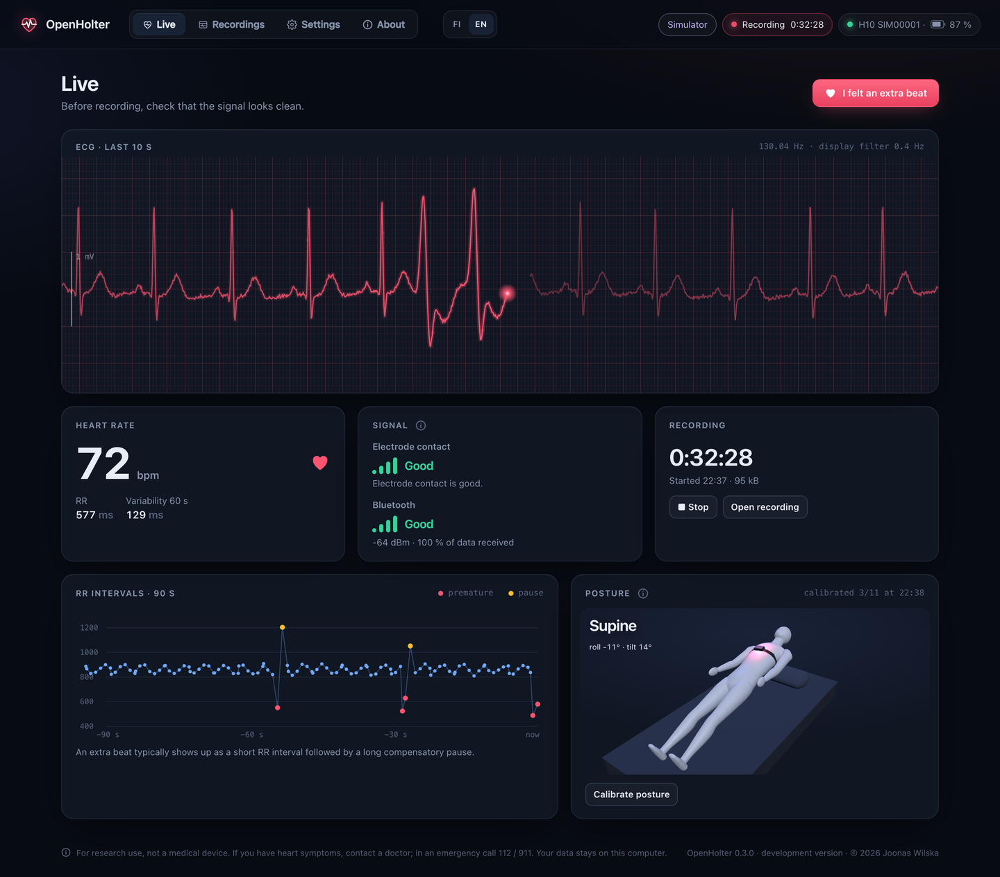
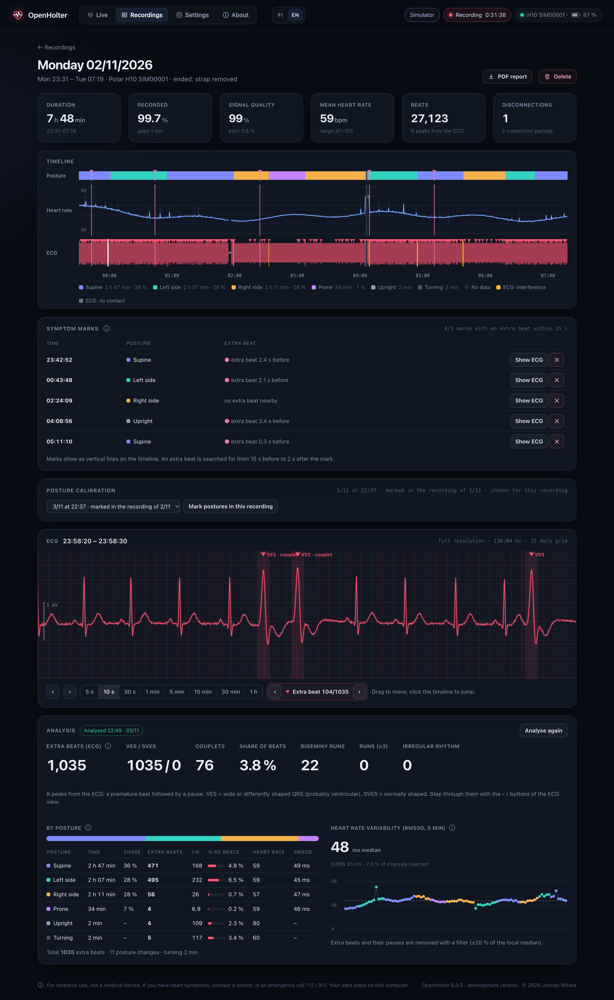
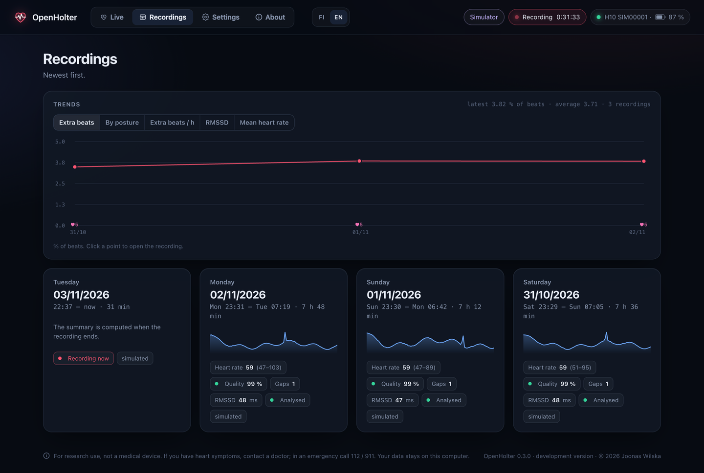
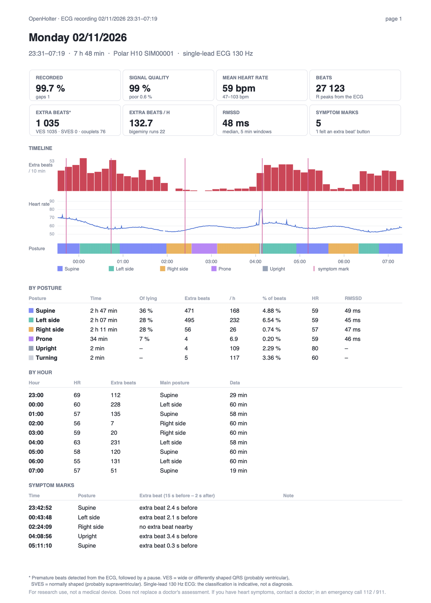
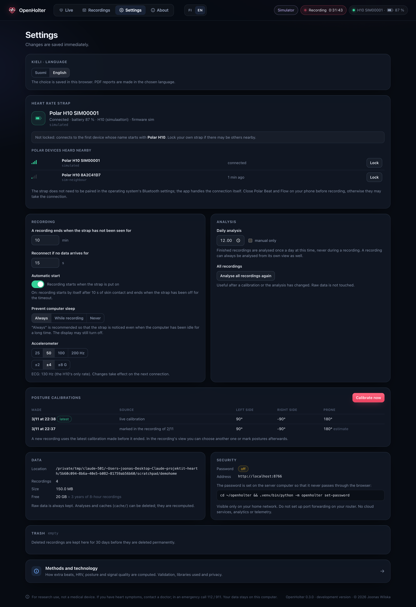
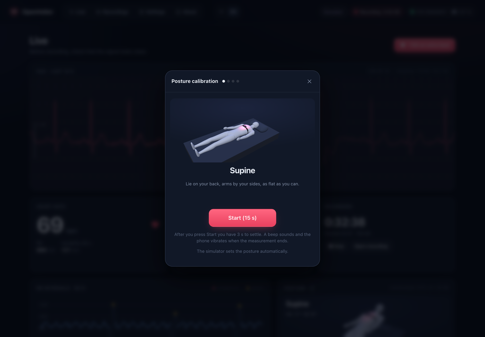
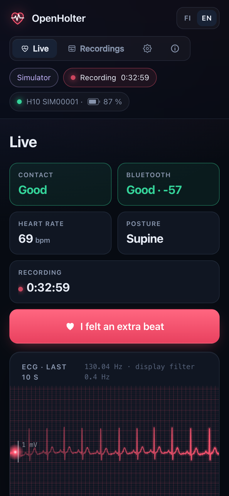

# OpenHolter

**An open-source ECG recorder for the Polar H10 chest strap: every beat analysed, every result openly validated.**

🇫🇮 [Suomeksi](README.fi.md)



OpenHolter turns a Polar H10 heart-rate strap and a computer into a Holter-style ECG recorder.
The strap streams its single-lead ECG (130 Hz) and accelerometer over Bluetooth; the computer records for as long as you like,
finds every heartbeat in the ECG, flags extra beats (VES/SVES), tells you which body posture they happen in,
and gives you a PDF report with the full ECG for your doctor. All data stays on your own computer: no cloud, no account, no telemetry.

> [!IMPORTANT]
> **For research and personal use only. Not a medical device.**
>
> OpenHolter is an open-source research project. It is not intended to diagnose, treat, monitor or prevent any disease,
> and its results do not replace a doctor's assessment. Do not change your medication or treatment based on them.
> OpenHolter cannot detect a heart attack and does not alert you to dangerous arrhythmias.
>
> **If you have heart symptoms, such as chest pain or pressure, shortness of breath, fainting or dizziness, contact a doctor.
> In an emergency, call your local emergency number (112 in Europe, 911 in the US).**
>
> The raw ECG is always kept in full, so the automatic analysis is an extra layer that never replaces looking at the trace.

## Results at a glance

The beat analysis has been tested the way commercial arrhythmia algorithms are: against cardiologist-labelled reference
databases, following ANSI/AAMI EC57: the [MIT-BIH Arrhythmia Database](https://physionet.org/content/mitdb/1.0.0/) and the
[St Petersburg INCART 12-lead Arrhythmia Database](https://physionet.org/content/incartdb/1.0.0/) (PhysioNet). Version 5 was tuned only on half of MIT-BIH (DS1);
the other half (DS2) and INCART (75 recordings, about 142,000 beats) are untouched test data.

| Sensitivity / precision | [MIT-BIH](https://physionet.org/content/mitdb/1.0.0/) (44 recordings) | [INCART](https://physionet.org/content/incartdb/1.0.0/) (75 recordings) |
|---|---:|---:|
| **Beat (QRS) detection** | **97.4 % / 99.9 %** | **95.3 % / 99.6 %** |
| **VES** (ventricular extra beats) | **68.0 % / 92.5 %** | **59.3 % / 89.7 %** |
| VES, typical single beat + pause | 79.4 % | 73.7 % |
| SVES (supraventricular extra beats) | 30.4 % / 68.3 % | 70.1 % / 57.1 % |

- **Beats are found reliably**: 97 % of all heartbeats, with almost no false detections.
- **A VES mark is usually right** (about 9 out of 10), and about two out of three VES beats are found
  (version 4: half). Typical single extra beats followed by a pause, the most common kind, are found in about 3 out of 4 cases.
- **SVES detection is not yet reliable**, see [Known weaknesses](#known-weaknesses-and-what-comes-next).

Full method, per-record tables and how to rerun the test yourself: [docs/VALIDATION.en.md](docs/VALIDATION.en.md).
The numbers are for the algorithm on reference Holter recordings; the H10's chest lead is different (see below).

## Screenshots

*All screenshots use the built-in simulator, not real patient data.*

| | |
|---|---|
|  |  |
| **A recording:** posture, heart rate and ECG timeline, symptom marks, the ECG at full resolution with VES marked, and the analysis by posture. | **Recordings and trends** across recordings. |
|  |  |
| **PDF report** for your doctor: summary, ECG strips at 25 mm/s and full disclosure of the whole recording. | **Settings** in the browser: lock your own strap, automatic recording, sleep prevention, daily analysis, trash. |
|  |  |
| **Posture calibration** with a 3D figure; the phone works as a remote control. | **On the phone:** check the signal and press *I felt an extra beat* when you feel one. |

## Features

- **Live view:** ECG sweep, heart rate, RR intervals, electrode contact and Bluetooth link quality, and a 3D figure of your posture.
  Nothing is shown until the strap reports skin contact.
- **Automatic recording** when the strap is put on (10 s of steady skin contact), automatic stop when it is taken off. Can be switched off.
- **Analysis** (daily, never during a recording, or from a button): R peaks from the ECG, premature beats classified as VES/SVES by QRS shape,
  couplets, runs and bigeminy, extra beats by posture and by hour, HRV (RMSSD/SDNN).
  Irregular-rhythm episodes (compatible with atrial fibrillation) and runs of ≥ 3 extra beats are reported (indicative).
- **Posture** from the accelerometer, with a guided calibration and retro-calibration from a recording.
- **Symptom marker:** "I felt an extra beat"; the recording shows what the ECG did at that moment.
- **PDF report:** summary, ECG strips and full disclosure.
- **Trends** across recordings, **trash** with 30-day retention, **settings** in the browser.
- **Finnish and English** user interface and PDF (switch in the top bar).
- **Analysis improves retroactively:** it is always recomputed from the raw data, so a better version also re-analyses old recordings.
- **Validated openly** against the MIT-BIH and INCART databases.

## Known weaknesses and what comes next

We publish the weaknesses with the same care as the strengths. In version 5:

- **The VES count is probably too low.** About a third of VES beats are still missed, especially in ventricular
  tachycardia and when the QRS is small or unusually shaped (MIT-BIH records 203, 208, 228).
- **The SVES count can be wrong in both directions.** 30–40 % of SVES marks may be false, and many true ones are missed.
  Version 5 improved SVES a lot on the tuning data, but **not on the test data**: on DS2 and INCART it is weaker than version 4.
  The reason is that frequent atrial extra beats and atrial tachycardias can look like an irregular rhythm, and no SVES are marked during one.
- **Irregular-rhythm (atrial fibrillation) detection is indicative only.** On MIT-BIH it finds 82 % of the beats in such episodes,
  but on INCART it found neither of the two atrial fibrillation recordings and gave false episodes in 12 recordings.
- **Different device, different lead.** The reference databases were recorded with Holter devices using limb leads.
  The H10 records one chest lead at 130 Hz, which shows P waves and QRS shape less clearly than a 12-lead ECG.
  The accuracy with the strap itself has not yet been measured against a reference.
- **What this means in practice:** the automatic marks guide where to look; they do not replace looking.
  A missed extra beat is still in the trace, just not highlighted. That is why the full ECG is in the report and why
  symptom marks matter: they point to the moments worth checking.

**Plan for version 6:**

1. **SVES without the irregular-rhythm trap:** keep marking supraventricular beats inside irregular stretches when they
   follow a repeating pattern, and report atrial runs and tachycardias separately instead of suppressing them.
2. **Better atrial fibrillation detection:** combine irregularity with entropy-type measures and the absence of a repeating pattern,
   and validate on a dedicated atrial fibrillation database (MIT-BIH Atrial Fibrillation Database) in addition to INCART.
3. **Fewer missed VES:** several beat templates per recording instead of one, and better detection of small or wide QRS complexes and ventricular runs.
4. **Validation with the strap itself:** recordings with the H10 worn together with a clinical Holter, compared beat by beat.
5. **Same rules as now:** tuning only on DS1, test data used once after the parameters are locked, and every result
   published, including the ones that get worse.

Contributions to any of these are very welcome, see [CONTRIBUTING.md](CONTRIBUTING.md).

## Structure

```
openholter/
  pmd.py         Polar PMD protocol: commands, frame decoding (ECG int24 µV, ACC int16 mG), heart rate service
  collector.py   bleak connection, reconnection, watchdog, sessions, skin-contact logic, resume after a crash
  storage.py     session folders, hourly gzip chunks, metadata as JSON
  sessions.py    decoding a recording into a timeline, decimation, summaries
  beats.py       R-peak detection and extra-beat classification from the ECG
  analysis.py    analysis process: posture, extra beats, HRV, per posture / per hour
  posture.py     calibration and posture classification
  report.py      PDF report (reportlab)
  validation.py  MIT-BIH validation (own WFDB readers)
  live.py        live buffers and WebSocket fan-out
  server.py      FastAPI + basic auth
  i18n.py        server-side language (error messages, PDF)
  power.py       sleep prevention on macOS, Windows and Linux
  simulator.py   synthetic H10 for development (same bytes as the real strap)
  static/        user interface (no build step, no CDN); i18n.js + i18n-en.js for languages
scripts/         deploy, LaunchAgent install/uninstall, Blender script for the 3D figure
tests/           protocol, storage, analysis and report tests
docs/            validation report and results
```

One process runs both the collector and the web server in a single asyncio loop. Analyses and PDFs run in a
separate low-priority process.

### Storage format

```
~/openholter-data/
  config.json
  logs/openholter.log                rotated, 5 × 5 MB
  calibrations/                      one file per posture calibration
  sessions/2026-10-28_231900/
    meta.json                        start/end, device, settings, connection periods and gaps, events
    chunk-0000.rec.gz                one per hour, raw BLE notifications + timestamps
    cache/                           derived data, can be deleted at any time
```

Every record holds the wall-clock time (`time.time_ns`), a monotonic time and the raw PMD or HR notification as it was received.
Sample spacing comes from the H10's own clock (~130.0x Hz); wall-clock time is fitted to it per connection with drift correction.
The gzip stream is flushed every 2 s, so a crash loses at most a couple of seconds, and even an unfinished file can be read.
About 2 MB per hour.

## Development (without a strap)

```bash
python3 -m venv .venv && .venv/bin/pip install -e .
export OPENHOLTER_HOME=/tmp/openholter-dev
.venv/bin/python -m openholter simulate-night --hours 7.5      # a ready simulated recording
.venv/bin/python -m openholter run --simulate                  # live simulator, http://localhost:8765
.venv/bin/python tests/test_pipeline.py
```

The simulator produces the same bytes as the H10, so the whole chain from the parser to the UI is exercised for real.
A simulated recording has posture changes, extra beats, an electrode coming loose and a Bluetooth gap; the true times
of the extra beats are written to `simulation_truth.json`.

## Installation (macOS)

**1. Python.** Python 3.9 or newer. On macOS the Command Line Tools Python works; python.org's installer is fine too.

**2. Code.** From your main computer:

```bash
./scripts/deploy.sh <ssh-name-of-the-mac>
```

The script copies the code to `~/openholter`, creates `.venv` and installs the dependencies.

**3. First test in the Mac's own Terminal** (screen or Screen Sharing, not SSH). macOS asks for Bluetooth permission
from the app that started the process, and that cannot be granted over SSH:

```bash
cd ~/openholter && .venv/bin/python -m openholter doctor
.venv/bin/python -m openholter probe --seconds 20
```

Moisten the electrodes and put the strap on. `probe` prints the supported measurements and ECG, ACC and HR lines
(about 130 ECG samples/s and 50 ACC samples/s).

**4. Password for the UI (recommended):**

```bash
.venv/bin/python -m openholter set-password
```

Only a PBKDF2 hash is stored in `~/openholter-data/config.json` (permissions 600).

**5. Background service:**

```bash
./scripts/install-launchagent.sh
```

The agent starts at login and launchd restarts it if it crashes; an interrupted recording continues as the same session.
Turn on automatic login (System Settings → Users & Groups) so the agent also starts after a power cut.

**6. Open** `http://<mac>.local:8765` in a browser on your home network.

### Bluetooth permission

macOS records the Bluetooth permission (TCC) for the program responsible for the process:

| How it runs | Permission is asked for |
|---|---|
| In Terminal.app | **Terminal** |
| As a LaunchAgent | **the Python interpreter itself** (`…/Python.app`) |
| Over SSH | cannot be granted |

`openholter doctor` prints the exact Python.app path and the permission state. If the LaunchAgent cannot reach the strap:
System Settings → Privacy & Security → Bluetooth → add that `Python.app` (Cmd+Shift+G in the file dialog), then
`launchctl kickstart -k gui/$(id -u)/fi.wilska.openholter`.

### Sleep

By default (`prevent_sleep: "always"`) the app keeps the computer awake while it runs (macOS `caffeinate`, Windows
`SetThreadExecutionState`, Linux `systemd-inhibit`), so a strap put on later is noticed. The display may still turn off.
With `"recording"` sleep is prevented only during a recording.

## Installation (Windows)

> Windows support is new and **not yet tested with a real strap**. The code paths are there (Bluetooth through Windows'
> own Bluetooth LE stack, sleep prevention with `SetThreadExecutionState`), but please report what works and what does not.
> The computer needs Bluetooth 4.0 (LE); Windows 10 or 11.

**1. Python.** Install Python 3.9 or newer from [python.org](https://www.python.org/downloads/windows/).
In the installer, tick **Add python.exe to PATH**.

**2. Code.** Download the code (*Code → Download ZIP* on GitHub, or `git clone`), for example to `C:\OpenHolter`, and in PowerShell:

```powershell
cd C:\OpenHolter
py -m venv .venv
.venv\Scripts\pip install -e .
```

**3. First test.** Moisten the electrodes, put the strap on and run:

```powershell
.venv\Scripts\python -m openholter doctor
.venv\Scripts\python -m openholter probe --seconds 20
```

Expect about 130 ECG samples/s and 50 ACC samples/s. Windows does not ask for a separate Bluetooth permission for
programs, but Bluetooth must be on (Settings → Bluetooth & devices). There is no need to pair the strap.

**4. Password for the UI (recommended):**

```powershell
.venv\Scripts\python -m openholter set-password
```

**5. Start automatically at login** (Task Scheduler; `pythonw` runs without a console window):

```powershell
schtasks /Create /TN OpenHolter /SC ONLOGON /RL LIMITED /TR "C:\OpenHolter\.venv\Scripts\pythonw.exe -m openholter run"
schtasks /Run /TN OpenHolter
```

To remove it: `schtasks /Delete /TN OpenHolter /F`. The log is in `%USERPROFILE%\openholter-data\logs\openholter.log`.

**6. Open** `http://localhost:8765` on the same computer, or `http://<computer-name>:8765` on your home network.
When Windows Defender Firewall asks, allow Python on **private networks only**.

Differences from macOS: the Bluetooth signal strength (dBm) is not shown on Windows (the link quality still is),
and the data folder is `C:\Users\<you>\openholter-data`.

## Installation (Linux)

> Linux support is new and **not yet tested with a real strap**. Bluetooth goes through BlueZ (via bleak) and sleep
> prevention through `systemd-inhibit`. Please report what works and what does not.

**1. Packages.** Python 3.9 or newer with venv, and BlueZ (on most desktop distributions already installed). Debian/Ubuntu:

```bash
sudo apt install python3 python3-venv bluez
systemctl status bluetooth        # should be "active (running)"
```

**2. Code.** `git clone https://github.com/JoonasFI/OpenHolter.git ~/openholter` (or `./scripts/deploy.sh <host>` from another
computer over SSH), then:

```bash
cd ~/openholter && python3 -m venv .venv && .venv/bin/pip install -e .
```

**3. First test.** No separate Bluetooth permission is needed, and the strap does not need to be paired.
Moisten the electrodes, put the strap on and run:

```bash
.venv/bin/python -m openholter doctor
.venv/bin/python -m openholter probe --seconds 20
```

**4. Password for the UI (recommended):** `.venv/bin/python -m openholter set-password`

**5. Start automatically** as a systemd user service. Create `~/.config/systemd/user/openholter.service`:

```ini
[Unit]
Description=OpenHolter ECG recorder

[Service]
ExecStart=%h/openholter/.venv/bin/python -m openholter run
Environment=OPENHOLTER_NO_STDERR=1
Restart=on-failure
RestartSec=10

[Install]
WantedBy=default.target
```

```bash
systemctl --user daemon-reload
systemctl --user enable --now openholter
loginctl enable-linger "$USER"     # keep it running also when you are not logged in
journalctl --user -u openholter -f # status; the log file is ~/openholter-data/logs/openholter.log
```

**6. Open** `http://<computer>.local:8765` on your home network. If a firewall is on, allow port 8765 from your home
network only, for example `sudo ufw allow from 192.168.0.0/16 to any port 8765`.

Differences from macOS: the Bluetooth signal strength (dBm) is not shown (the link quality still is). Without an active
desktop session, preventing sleep may need extra permission from polkit; if the computer still sleeps, turn automatic
suspend off in the system settings.

## Use

- **Before recording:** put the strap on and check in the Live view that *Electrode contact* is *Good* and the ECG looks clean.
  Recording starts automatically.
- **During recording:** gaps (moving out of range) are logged and the connection comes back by itself.
  The session ends when the strap has not been seen for 10 minutes (`session_timeout_min`).
- **Afterwards:** the *Recordings* view shows heart rate, posture and the ECG overview with interference and missing contact coloured.
  Pick a moment to see the ECG at full resolution.

## Settings (`~/openholter-data/config.json`, most also in the browser)

| Key | Default | |
|---|---|---|
| `device_name_prefix` | `"Polar H10"` | first strap found |
| `device_address` | `null` | lock to one strap |
| `auto_record` | `true` | start recording when the strap is put on |
| `acc_sample_rate` / `acc_range_g` | `50` / `4` | H10: 25/50/100/200 Hz, 2/4/8 G |
| `session_timeout_min` | `10` | |
| `data_timeout_s` | `15` | reconnect if no data arrives |
| `prevent_sleep` | `"always"` | `always` / `recording` / `never` |
| `analysis_time` | `"12:00"` | daily analysis of finished recordings, `""` = button only |
| `host` / `port` | `0.0.0.0` / `8765` | **do not expose the port to the internet** |

The UI language is chosen per browser (FI/EN in the top bar).

## Troubleshooting

```bash
tail -f ~/openholter-data/logs/openholter.log
launchctl print gui/$(id -u)/fi.wilska.openholter | head -30
.venv/bin/python -m openholter doctor
```

- *Strap not found:* the H10 wakes up only when the electrodes are moist and it is on the skin. Polar Beat or another app
  may hold the connection; close it on your phone.
- *ECG start failed:* the H10 firmware may be old. Update it with Polar Flow.
- *Live shows "No contact":* moisten the electrodes. On dry skin the first minutes are often noisy.

## Translating

The Finnish text is the key. To add a language, copy `openholter/static/i18n-en.js`, translate the values, add the
language to `LANGS` in `i18n.js` and load the file in `index.html`. Server messages and the PDF use `tr(fi, en)` /
`T(fi, en)` in `openholter/i18n.py` and `openholter/report.py`.

## License

OpenHolter is free software under the [GNU Affero General Public License v3.0 or later](LICENSE) (AGPL-3.0-or-later).
If you run a modified version as a network service, you must offer its source code to its users.

Third-party parts: three.js (MIT, see `openholter/static/vendor/three.LICENSE`).

**Commercial licence.** If the AGPL does not suit your use (for example a closed product or service), a commercial
licence is available: contact the author (Joonas Wilska, joonas@wilska.fi).

Contributing: see [CONTRIBUTING.md](CONTRIBUTING.md).

*OpenHolter is not a medical device and is not intended for diagnosis or treatment decisions.*
